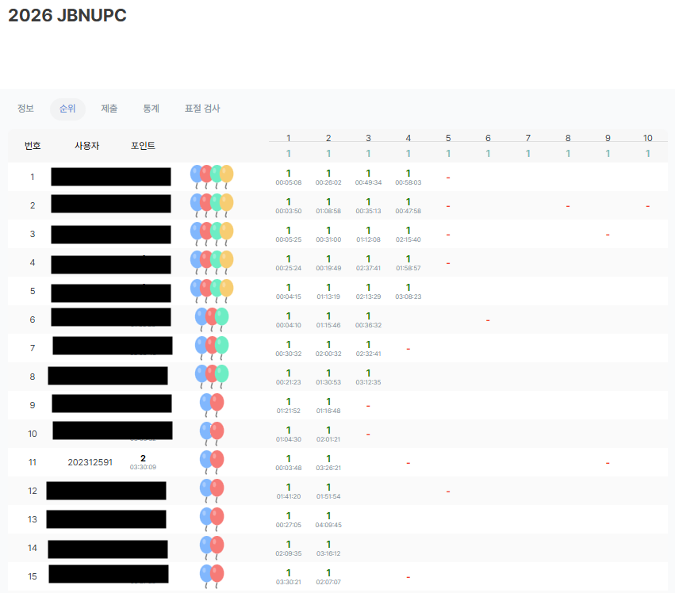

## 1. 참가 일자와 형태

- 참가 일자: 2026년 5월 9일
- 참가 형태: 개인전
- 대회명: JBNUPC
- 결과: 전체 11위, 5문제 중 2문제 해결

## 2. 참가 목적

현재 코딩 실력이 어느 정도인지 확인하고,
프로그래밍 대회가 어떤 방식으로 진행되는지 직접 경험하고 싶어
참가했습니다.

## 3. 준비 과정과 본인 활동

백준 문제와 이전 대회 문제를 풀며 대회를 준비했습니다.

준비 과정에서 sys 모듈을 활용한 입력 처리 방법을 접하고,
문제 풀이에 필요한 Python 사용법을 학습했습니다.

개인전으로 참가하여 문제 분석과 풀이 구현을 직접 수행했습니다.

## 4. 대회에서 겪은 어려움

총 5문제 중 2문제를 해결했습니다.
다른 풀이를 시도하는 과정에서는 시간 초과(TLE)를 경험했습니다.

풀이를 코드로 옮기는 능력뿐 아니라,
제한 시간 안에 실행할 수 있는 알고리즘을 선택하는 능력도
필요하다는 점을 체감했습니다.

- 기억에 남는 문제: 그 때 당시에 DFS BFS 개념이 어려워 공부를 많이 해뒀는데 관련 문제가 나와서 수월하게 해결할 수 있었습니다.
- 시도한 접근과 막힌 부분: 이진 탐색에 대해 제대로 알지 못해 TLE 오류가 나 해결하지 못한 문제도 있었습니다.

## 5. 참가 결과와 증빙

전체 11위를 기록했으며, 5문제 중 2문제를 해결했습니다.

## 6. 배운 점과 이후 계획

이번 대회를 통해 실제 제한 시간 안에서 문제를 해결하는 경험을 쌓고,
알고리즘과 자료구조 학습의 필요성을 확인했습니다.

해결하지 못한 문제는 시간 초과 원인을 분석하고,
더 적합한 알고리즘과 자료구조를 적용할 수 있는지 복습할 계획입니다.
